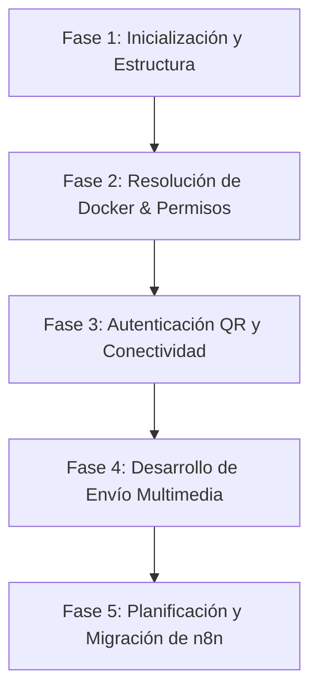

# 📊 Evaluación de Prompts y Flujo de Trabajo Agéntico

## Proyecto: whatsappAPI
**Fecha de Evaluación:** 6 de julio de 2026  
**Evaluador:** Roberto (AI Workflow Analyst)

---

## Resumen Ejecutivo

Este informe presenta un análisis exhaustivo del flujo de trabajo y la calidad de los prompts utilizados por el desarrollador en el proyecto **whatsappAPI**. El objetivo principal del proyecto fue reemplazar el servicio Green API mediante una solución autohospedada basada en la librería **Baileys**, conectándola con flujos en **n8n** en un entorno VPS con recursos críticos de almacenamiento y RAM.

A lo largo de la conversación, el desarrollador demostró una **alta madurez metodológica**, aplicando conceptos de Desarrollo Guiado por Especificaciones (Spec-Driven Development) y gestionando de forma excelente el alcance y el control sobre las acciones del agente. Los principales puntos fuertes radican en la supervisión activa (frenar al agente cuando corre de más) y la resolución lógica de errores complejos (como el problema de la librería de procesamiento de imágenes `sharp` en Docker). 

Las áreas de mejora son menores pero importantes para la seguridad y la eficiencia: evitar el paso de credenciales y contraseñas en texto plano dentro del prompt, y reducir los errores tipográficos que podrían confundir al modelo en instrucciones críticas.

### 🏆 Puntuación General: **8.8 / 10**

---

## Metodología

La evaluación se realizó mediante el análisis del archivo de log de la conversación `transcript.jsonl` bajo el ID `0a9170ca-a124-471c-a084-d34fcca2542b`. Se extrajeron y categorizaron todos los mensajes de entrada del usuario (`USER_INPUT`) y las respuestas del planificador (`PLANNER_RESPONSE`).

Adicionalmente, se contrastó el comportamiento del usuario con las **mejores prácticas de Ingeniería de Prompts y Desarrollo Agéntico de 2025/2026**, enfocadas en:
1. **Spec-Driven Development (SDD)**: Tratamiento de requerimientos como contratos vivos.
2. **Context Engineering**: Gestión eficiente del contexto y límites de tokens.
3. **Seguridad y Control**: Manejo seguro de secretos y prevención de "vibe-coding".

---

## Análisis del Historial de Conversaciones

El desarrollo de la API de WhatsApp con Baileys se estructuró en varias fases identificadas en el transcript:

### Hitos clave analizados:
* **Freno metodológico inicial:** El desarrollador detuvo al agente en el segundo paso para exigir el uso de un archivo `requisitos.md` antes de empezar a escribir código.
* **Depuración de dependencias:** Superación de errores en el build de Docker y compatibilidad de miniaturas (`sharp`) sin comprometer el entorno de la VPS.
* **Migración segura:** Creación de un plan nodo a nodo antes de aplicar cambios en flujos de producción de n8n.

---

## Evaluación por Dimensiones

### a) Claridad y Especificidad del Prompt
> **Puntuación: 8.0 / 10**

*   **Análisis:** Las instrucciones son directas y orientadas a la acción. El usuario sabe exactamente qué quiere lograr técnicamente. Sin embargo, hay una presencia notable de errores tipográficos debido a la rapidez de escritura (ej. *"has un fetcha para ver todos mis chat"*, *"vamsoa manejar dos moviels"*, *"no aborta cambiar de distribucion"*).
*   **Ejemplo de prompt:**
    > *"ya el problema es que ha expirado el qr ya se ha coencatdo el whatsapp con etse nuemero has un fetcha para ver todos mis chat y grupso en general"*
*   **Crítica:** Aunque los LLM modernos interpretan con éxito estos errores (gracias al contexto), escribir con demasiados typos incrementa el riesgo de malentendidos en instrucciones críticas del sistema de archivos.

### b) Gestión del Contexto
> **Puntuación: 8.5 / 10**

*   **Análisis:** Excelente transferencia de restricciones ambientales (la VPS tiene memoria/disco críticos, otros proyectos corren en la misma imagen de Docker).
*   **Antipatrón detectado:** El usuario introdujo credenciales reales y contraseñas temporales en los prompts para que el agente hiciera pruebas o configuraciones de SSH/Docker.
*   **Ejemplo de prompt:**
    > *"Fahrenehit451/314159 prueba con esta o sino Fahrenheit451"*
    > *"usa la sigueitne api key REDACTED_BAILEYS_API_KEY guardala en la vps en le proyetco"*
*   **Crítica:** Compartir claves de API y contraseñas de VPS en el historial de chat con un LLM expone los secretos a los logs de la plataforma y viola las políticas de seguridad.

### c) Control de Alcance (Scope Control)
> **Puntuación: 9.0 / 10**

*   **Análisis:** Espectacular control del ritmo de trabajo del agente. Los desarrolladores principiantes suelen dejar que el agente genere miles de líneas de código antes de probar. Aquí, el usuario dividió las tareas en micro-pasos (autenticar -> probar texto -> probar imagen -> planificar n8n).
*   **Ejemplo de prompt:**
    > *"bien vamos a detenerno ya que vas demasiado rapido y has incumplido varias relgas de trabajp 1 estamos trabjando en e l entorno de genterlma ia basado en ssd..."*

### d) Manejo de Errores y Recuperación
> **Puntuación: 9.5 / 10**

*   **Análisis:** El desarrollador muestra un criterio técnico sobresaliente al rechazar soluciones sobredimensionadas del asistente de IA. Cuando la librería de manipulación de imágenes (`sharp`) falló por dependencias del sistema operativo, el agente sugirió cambiar la distro de Docker. El usuario abortó de inmediato esa sugerencia por el riesgo de romper otros proyectos activos.
*   **Ejemplo de prompt:**
    > *"no aborta cambiar de distribucion bajo ningun concepto peudes hacer esto deseanas de proyecos ya estan trabajando con la img actual..."*

### e) Enfoque Plan-First / Spec-Driven (SDD)
> **Puntuación: 9.5 / 10**

*   **Análisis:** Cumplimiento riguroso de las directrices de Spec-Driven Development. El usuario exigió planes de migración detallados paso a paso antes de que el agente editara nodos en producción de n8n.
*   **Ejemplo de prompt:**
    > *"disnea un plan detallad odonde explquies flujo a flujo nod oa nodo todos los cambiso que vas a aplciar y porque quiero que quede palsmado hasta la ultiam linea am doficar y el motivo del mismo"*

### f) Madurez del Flujo de Trabajo Agéntico
> **Puntuación: 8.5 / 10**

*   **Análisis:** El usuario trata al agente como un copiloto que requiere supervisión continua. Entiende sus límites (como la deformación visual del QR en la consola) y propone soluciones creativas alternativas (generar el archivo `qr.png` y descargarlo localmente por SCP).

### g) Comunicación Técnica
> **Puntuación: 8.5 / 10**

*   **Análisis:** El vocabulario utilizado es preciso (`endpoints`, `Baileys`, `buildx`, `Express`, `cron`, `n8n`). Esto permite que el agente use las herramientas correctas del sistema.

---

## Resumen de Puntuaciones

| Dimensión | Puntuación | Nota Principal |
| :--- | :---: | :--- |
| **Claridad y Especificidad** | 8.0/10 | Alta claridad de objetivos pero propensión a typos. |
| **Gestión del Contexto** | 8.5/10 | Buena transferencia de límites, pero con filtración de credenciales. |
| **Control de Alcance** | 9.0/10 | Excelente fragmentación del trabajo. |
| **Manejo de Errores** | 9.5/10 | Criterio técnico firme ante soluciones arriesgadas del agente. |
| **Enfoque Plan-First** | 9.5/10 | Riguroso uso de especificaciones y planes de impacto. |
| **Madurez del Flujo** | 8.5/10 | Entendimiento óptimo del agente como un asistente supervisado. |
| **Comunicación Técnica** | 8.5/10 | Uso preciso de la jerga de desarrollo. |

---

## Fortalezas Identificadas

1.  **Mentalidad Spec-First (SDD):** El desarrollador comprende que el código es una consecuencia directa de una especificación detallada. Mantener actualizado `requisitos.md` antes de implementar previene desvíos técnicos.
2.  **Supervisión Activa y Asertiva:** La capacidad de decir "no" y "detente" al agente es la habilidad número uno para evitar que la IA arruine código en entornos de producción.
3.  **Habilidad en Depuración (Troubleshooting):** Suministrar logs de error exactos y corregir hipótesis erróneas de la IA de forma constructiva.

---

## Áreas de Mejora Prioritarias

> [!WARNING]
> ### 1. Exposición de Secretos y Credenciales en Prompts
> **Gravedad:** Alta  
> **Problema:** Proporcionar API keys y passwords de la VPS en texto plano dentro del chat.
> **Solución:** Utilizar variables de entorno (`.env`), archivos de credenciales protegidos o pedirle al agente que lea la variable de manera interactiva sin escribirla en el chat.

> [!NOTE]
> ### 2. Control de Errores Ortográficos e Instrucciones
> **Gravedad:** Baja-Media  
> **Problema:** Palabras deformadas como *"requsitos.md"*, *"fetcha"*, *"coencatdo"*.
> **Solución:** Una breve revisión de los mensajes antes de enviar reduce la probabilidad de que el LLM confunda nombres de rutas o comandos del sistema.

---

## Recursos y Referencias

Para optimizar aún más el desarrollo con agentes en 2026, te recomendamos consultar los siguientes recursos:
*   [Guía de Anthropic sobre Context Engineering](https://docs.anthropic.com/en/docs/build-with-claude/prompt-engineering/use-xml-tags): Uso de delimitadores claros para aislar variables del sistema.
*   [Buenas prácticas en Spec-Driven Development](https://github.blog): Mantener las especificaciones sincronizadas con las pruebas unitarias.
*   [12 Factor App - Configuración](https://12factor.net/config): Principio de desacoplamiento de credenciales y código.

---

## Plan de Acción Sugerido

1.  **Implementar un Gestor de Secretos:** Crea un archivo `.env` en la raíz de `whatsappAPI` y configura al agente para que lea las API keys desde ahí mediante `process.env.API_KEY`, sin que vuelvan a aparecer en el chat.
2.  **Modularizar Tareas en n8n:** Dado el éxito en la migración de Green API a Baileys, documenta los nuevos endpoints en un archivo `API_SPEC.md` dentro del repo para futuros agentes que interactúen con el proyecto.
3.  **Mantener la plantilla de Especificaciones:** Continúa usando el archivo `requisitos.md` como el contrato principal de desarrollo. Cada vez que inicies un nuevo feature, pídele al agente que lea este archivo primero.
